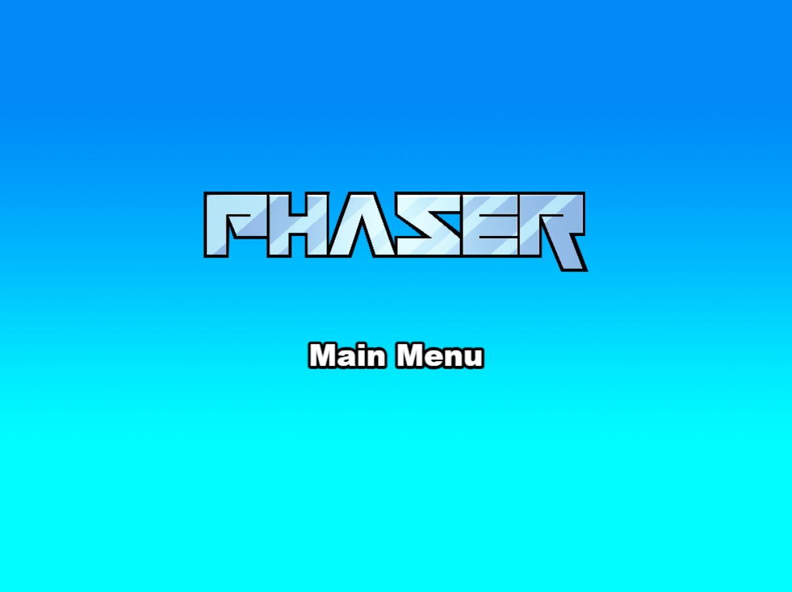

# Phaser Vite TypeScript Template

This is a Phaser project template that uses Vite for bundling. It supports hot-reloading for quick development workflow, includes TypeScript support and scripts to generate production-ready builds.

**[This Template is also available as a JavaScript version.](https://github.com/phaserjs/template-vite)**

### Versions

This template has been updated for:

- [Phaser 4](https://github.com/phaserjs/phaser)
- [React 19](https://github.com/facebook/react)
- [Vite 6.3.1](https://github.com/vitejs/vite)
- [TypeScript 5.7.2](https://github.com/microsoft/TypeScript)



## Requirements

[Node.js](https://nodejs.org) is required to install dependencies and run scripts via `npm`.

## Battle System

Battles are powered by the Pokémon Showdown simulator ([`@pkmn/sim`](https://www.npmjs.com/package/@pkmn/sim)). The integration lives in `src/battle/`. See **[docs/BATTLE_SYSTEM.md](docs/BATTLE_SYSTEM.md)** for how it works, how to edit teams and formats, and how to use it from a Phaser scene.

## Dialogue System

Dialogue, cutscenes and NPC scripts are written in [ink](https://www.inklestudios.com/ink/) and run with [inkjs](https://github.com/y-lohse/inkjs). Put `.ink` files in `content/dialogue/` and import them from TypeScript; a Vite plugin compiles them at build time. The runtime wrapper lives in `src/dialogue/`. See **[docs/DIALOGUE_SYSTEM.md](docs/DIALOGUE_SYSTEM.md)** for writing stories, choices, tags, variables, external functions, saving and using it from a Phaser scene.

## Game State and Saves

The party, PC, bag, flags, variables and the player's position are one plain-data `GameState` kept outside Phaser, in `src/state/`. `SaveManager` writes it to save slots (browser `localStorage` by default, three slots) as versioned JSON and checks every file it loads. The battle scene can fight with the saved party: it gains experience, effort values, levels and moves during the battle, the result is written back afterwards, and Pokémon that can then evolve are announced for an evolution scene. See **[docs/SAVE_SYSTEM.md](docs/SAVE_SYSTEM.md)**.

## UI

The UI is built with [React](https://react.dev) and drawn as HTML on top of the Phaser canvas, so it works in desktop browsers and in Android WebViews. Components go inside `<UiLayer>`, are laid out in game pixels (the game runs at 256×192) and follow the canvas when the screen or the game resolution changes. React and the scenes talk through an event bus. See **[docs/UI_SYSTEM.md](docs/UI_SYSTEM.md)**.

## Game Data

Pokémon, moves, abilities, items, natures, the type chart and learnsets are JSON files in `content/pbs/`, in Pokémon Showdown's data format. The official data is imported from [PokeAPI](https://pokeapi.co) with `npm run pokeapi:import` into `content/pbs/generated/`. Your own content and changes go in `content/pbs/custom/`, which is merged on top and can be split into content packs. Everything is validated with [Zod](https://zod.dev). See **[docs/DATA_PIPELINE.md](docs/DATA_PIPELINE.md)**.

## Sprites, Icons and Cries

Pokémon and item graphics and cries are imported from a Pokémon Essentials resource pack (such as the Generation 9 Resource Pack) with `npm run assets:import -- --pack <folder>`. Sprites land in `public/assets/img/pokemon/<species>/`, cries in `public/assets/sound/se/cries/` and item icons in `public/assets/items/`, named with Showdown IDs and reduced to 1× scale (battle sprites are 96×96). See **[docs/ASSET_PIPELINE.md](docs/ASSET_PIPELINE.md)**.

## Available Commands

| Command | Description |
|---------|-------------|
| `npm install` | Install project dependencies |
| `npm run dev` | Launch a development web server |
| `npm run build` | Create a production build in the `dist` folder |
| `npm run dev-nolog` | Launch a development web server without sending anonymous data (see "About log.js" below) |
| `npm run build-nolog` | Create a production build in the `dist` folder without sending anonymous data (see "About log.js" below) |
| `npm run typecheck` | Check all TypeScript code for type errors without building |
| `npm run pokeapi:import` | Import PokeAPI data into `content/pbs/generated` (see `docs/DATA_PIPELINE.md`) |
| `npm run pbs:validate` | Validate game data (generated + custom) |
| `npm run pbs:compare` | Compare game data with Pokémon Showdown's and list differences |
| `npm run pbs:schemas` | Regenerate JSON Schemas for editor autocompletion |
| `npm run assets:import -- --pack <folder>` | Import sprites, icons and cries from an Essentials resource pack (see `docs/ASSET_PIPELINE.md`) |
| `npm test` | Run the unit tests (tools, battle bridge, game state) |

## Writing Code

After cloning the repo, run `npm install` from your project directory. Then, you can start the local development server by running `npm run dev`.

The local development server runs on `http://localhost:8080` by default. Please see the Vite documentation if you wish to change this, or add SSL support.

Once the server is running you can edit any of the files in the `src` folder. Vite will automatically recompile your code and then reload the browser.

## Template Project Structure

We have provided a default project structure to get you started. This is as follows:

## Template Project Structure

We have provided a default project structure to get you started:

| Path                         | Description                                                |
|------------------------------|------------------------------------------------------------|
| `index.html`                 | A basic HTML page to contain the game.                     |
| `public/assets`              | Game sprites, audio, etc. Served directly at runtime.      |
| `public/style.css`           | Global layout styles.                                      |
| `src/main.tsx`               | Application bootstrap: mounts the React app.               |
| `src/App.tsx`                | Root React component: the game plus the UI layer.          |
| `src/PhaserGame.tsx`         | React component that creates the Phaser game.              |
| `src/ui`                     | React UI layer. See `docs/UI_SYSTEM.md`.                   |
| `src/game`                   | Folder containing the game code.                           |
| `src/game/main.ts`           | Game entry point: configures and starts the game.          |
| `src/game/config.ts`         | Game resolution (256×192).                                 |
| `src/game/EventBus.ts`       | Events between React and Phaser.                           |
| `src/game/scenes`            | Folder with all Phaser game scenes.                        |
| `src/battle`                 | Battle system (Pokémon Showdown integration). See `docs/BATTLE_SYSTEM.md`. |
| `src/dialogue`               | Dialogue system (inkjs integration). See `docs/DIALOGUE_SYSTEM.md`. |
| `src/state`                  | Game state and save system (party, PC, bag, flags, position). See `docs/SAVE_SYSTEM.md`. |
| `content/dialogue`           | ink story files (`.ink`), compiled by `vite/plugins/ink.mjs`. |
| `src/data`                   | Game data loader, Zod schemas and Showdown bridge. See `docs/DATA_PIPELINE.md`. |
| `content/pbs/generated`      | Game data imported from PokeAPI (do not edit). |
| `content/pbs/custom`         | Your data overrides and new content (content packs). |
| `tools`                      | Node tools: PokeAPI importer (`tools/pokeapi`), validator etc. (`tools/pbs`), asset importer (`tools/assets`). |


## Handling Assets

Vite supports loading assets via JavaScript module `import` statements.

This template provides support for both embedding assets and also loading them from a static folder. To embed an asset, you can import it at the top of the JavaScript file you are using it in:

```js
import logoImg from './assets/logo.png'
```

To load static files such as audio files, videos, etc place them into the `public/assets` folder. Then you can use this path in the Loader calls within Phaser:

```js
preload ()
{
    //  This is an example of an imported bundled image.
    //  Remember to import it at the top of this file
    this.load.image('logo', logoImg);

    //  This is an example of loading a static image
    //  from the public/assets folder:
    this.load.image('background', 'assets/bg.png');
}
```

When you issue the `npm run build` command, all static assets are automatically copied to the `dist/assets` folder.

## Deploying to Production

After you run the `npm run build` command, your code will be built into a single bundle and saved to the `dist` folder, along with any other assets your project imported, or stored in the public assets folder.

In order to deploy your game, you will need to upload *all* of the contents of the `dist` folder to a public facing web server.

## Customizing the Template

### Vite

If you want to customize your build, such as adding plugin (i.e. for loading CSS or fonts), you can modify the `vite/config.*.mjs` file for cross-project changes, or you can modify and/or create new configuration files and target them in specific npm tasks inside of `package.json`. Please see the [Vite documentation](https://vitejs.dev/) for more information.

## About log.js

If you inspect our node scripts you will see there is a file called `log.js`. This file makes a single silent API call to a domain called `gryzor.co`. This domain is owned by Phaser Studio Inc. The domain name is a homage to one of our favorite retro games.

We send the following 3 pieces of data to this API: The name of the template being used (vue, react, etc). If the build was 'dev' or 'prod' and finally the version of Phaser being used.

At no point is any personal data collected or sent. We don't know about your project files, device, browser or anything else. Feel free to inspect the `log.js` file to confirm this.

Why do we do this? Because being open source means we have no visible metrics about which of our templates are being used. We work hard to maintain a large and diverse set of templates for Phaser developers and this is our small anonymous way to determine if that work is actually paying off, or not. In short, it helps us ensure we're building the tools for you.

However, if you don't want to send any data, you can use these commands instead:

Dev:

```bash
npm run dev-nolog
```

Build:

```bash
npm run build-nolog
```

Or, to disable the log entirely, simply delete the file `log.js` and remove the call to it in the `scripts` section of `package.json`:

Before:

```json
"scripts": {
    "dev": "node log.js dev & dev-template-script",
    "build": "node log.js build & build-template-script"
},
```

After:

```json
"scripts": {
    "dev": "dev-template-script",
    "build": "build-template-script"
},
```

Either of these will stop `log.js` from running. If you do decide to do this, please could you at least join our Discord and tell us which template you're using! Or send us a quick email. Either will be super-helpful, thank you.

## Join the Phaser Community!

We love to see what developers like you create with Phaser! It really motivates us to keep improving. So please join our community and show-off your work 😄

**Visit:** The [Phaser website](https://phaser.io) and follow on [Phaser Twitter](https://twitter.com/phaser_)<br />
**Play:** Some of the amazing games [#madewithphaser](https://twitter.com/search?q=%23madewithphaser&src=typed_query&f=live)<br />
**Learn:** [API Docs](https://newdocs.phaser.io), [Support Forum](https://phaser.discourse.group/) and [StackOverflow](https://stackoverflow.com/questions/tagged/phaser-framework)<br />
**Discord:** Join us on [Discord](https://discord.gg/phaser)<br />
**Code:** 2000+ [Examples](https://labs.phaser.io)<br />
**Read:** The [Phaser World](https://phaser.io/community/newsletter) Newsletter<br />

Created by [Phaser Studio](mailto:support@phaser.io). Powered by coffee, anime, pixels and love.

The Phaser logo and characters are &copy; 2011 - 2025 Phaser Studio Inc.

All rights reserved.
